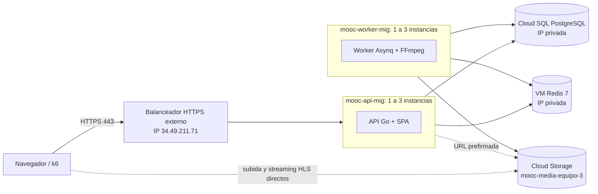

# Arquitectura elástica en GCP (Entrega 3)

> Borrador armado a partir de lo ya documentado en el repo (`capacity-planning/pruebas_de_carga_entrega3.md`,
> `deploy/startup/startup.sh`, `.github/workflows/deploy.yml`, `scripts/gcp/`, `docs/OPERACIONES.md`).
> La red, los health checks, el autohealing y el balanceo se verificaron en GCP el 1 de noviembre de 2026
> con `gcloud` (configuración efectiva, no la de las plantillas del repo).

## 1. Visión general

La Entrega 2 desplegaba dos VMs fijas (`web-server` y `worker-server`). En la Entrega 3 la API y
los workers corren en dos **grupos de instancias administrados (MIG)** independientes, detrás de un
**balanceador HTTPS externo**, y cada grupo escala solo con su propia señal: la API por CPU y los
workers por el número de trabajos en la cola.

## 2. Componentes

| Componente | Recurso en GCP | Función |
|---|---|---|
| Balanceador | External HTTPS Application Load Balancer, backend service `mooc-api-backend-service` (HTTP al puerto 80 de las instancias, modo `UTILIZATION` con máximo 0,8, sin afinidad de sesión, drenaje de conexiones de 30 s), certificado autofirmado | Punto de entrada único. Reparte el tráfico entre las instancias sanas de la API |
| API | MIG `mooc-api-mig`, `us-central1-a` | Backend Go (chi) que además sirve la SPA de React. Sin estado local |
| Workers | MIG `mooc-worker-mig`, `us-central1-a` | Procesan en segundo plano la transcodificación HLS (FFmpeg) desde la cola Asynq |
| Cola y caché | VM con Redis 7 fuera de los MIG | Cola de tareas, idempotencia y límite de tasa |
| Métricas de la cola | Contenedor `mooc-queue-metrics` en la VM de Redis (`backend/cmd/queue-metrics`) | Publica cada 15 s en Cloud Monitoring el estado de la cola; `custom.googleapis.com/mooc/asynq/backlog` es la señal de autoscaling de los workers |
| Logs | Cloud Logging (driver `gcplogs` de Docker) | Logs de los contenedores de cada instancia; se conservan después de que el autoscaler borra la VM |
| Base de datos | Cloud SQL PostgreSQL `mooc-db-instance`, red VPC privada | Persistencia transaccional |
| Objetos | Cloud Storage `mooc-media-equipo-3` | Videos originales, renditions HLS y materiales. Subida y descarga directas con URLs prefirmadas |
| Secretos | Secret Manager | Contenido del `.env` de cada rol |
| Imágenes | Artifact Registry | Imagen Docker única (`backend/Dockerfile`) con API, worker y SPA |

## 3. Elasticidad

| Parámetro | API | Worker |
|---|---|---|
| Mínimo / máximo de instancias | 1 / 3 | 1 / 3 |
| Métrica | CPU media 60 % (`target-cpu = 0.6`) | Trabajos en la cola (pendientes + activos), 2 por VM: `custom.googleapis.com/mooc/asynq/backlog`, métrica por grupo con `single-instance-assignment = 2` |
| Inicialización | 120 s | 180 s |
| Reducción | Estabilización de 10 min (GCE) y como máximo 1 VM cada 300 s | Igual |
| Health check | `GET /health` por HTTP en el puerto 80, cada 10 s, timeout de 5 s; sana tras 2 respuestas correctas y fuera tras 3 fallos. Lo usan el balanceador (`mooc-api-health-check`) y el autohealing del grupo (`mooc-api-hc`, espera inicial de 300 s) | Sin health check ni autohealing: el worker no recibe tráfico y su disponibilidad se observa en la cola y en sus logs |

Las políticas se aplican con `Set-ApiAutoscaling` y `Set-WorkerAutoscaling` (`scripts/gcp/config.ps1`),
que usan `encender.ps1` y `aplicar-autoscaling.ps1`. Detalle y justificación de los valores:
[`guia-escenario3-autoscaling.md`](guia-escenario3-autoscaling.md), sección 2 (C2).

- **Por qué dos grupos:** las transcodificaciones de video consumen mucha CPU. Separarlas evita que
  afecten la latencia de la API (en las pruebas la API se mantuvo bajo 90 ms con 10 subidas concurrentes).
- **Por qué es posible escalar:** ninguna instancia guarda estado propio. La persistencia está en
  PostgreSQL, los archivos en Cloud Storage y las colas, la idempotencia y el límite de tasa en Redis.
- **Por qué la cola para los workers:** la CPU de un worker no refleja cuántos trabajos esperan (con 2
  transcodificaciones ya está al 100 %), y una cola sin pendientes puede tener trabajos en curso. Contar
  pendientes + activos pide más workers cuando hay espera y no retira consumidores mientras procesan.
- **Encendido y apagado:** `scripts/gcp/encender.ps1` y `apagar.ps1` activan o desactivan el
  autoescalado de ambos MIG (1 a 3) y encienden o apagan Cloud SQL, para controlar el costo.

## 4. Aprovisionamiento de cada instancia

Todas las instancias se crean desde una plantilla con el mismo `startup-script`
(`deploy/startup/startup.sh`), que corre en cada arranque:

1. Lee de los metadatos de la plantilla el rol (`mooc-role`: `api` o `worker`), el secreto y la imagen.
2. Instala Docker si hace falta y obtiene un token de la cuenta de servicio de la VM.
3. Descarga el `.env` desde Secret Manager (sin credenciales en disco ni en el repositorio).
4. Descarga la imagen de Artifact Registry y arranca el contenedor: la API en los puertos 80 y 8080,
   el worker con `/app/worker`. Los dos reciben `INSTANCE_NAME` (la API lo devuelve en `X-Served-By`,
   junto con la versión en `X-App-Version`) y envían sus logs a Cloud Logging con el driver `gcplogs`.

La plantilla guarda una copia del script: para aplicar un cambio de `startup.sh` se crean plantillas
nuevas con `scripts/gcp/actualizar-plantillas.ps1`.

Al arrancar, la API aplica las migraciones bajo un *advisory lock* de PostgreSQL (`runMigrations` en
`backend/cmd/api/main.go`): si varias réplicas arrancan a la vez, una aplica el SQL y las demás esperan.
Una instancia está lista cuando `/health` responde 200, lo que ocurre después de las migraciones.

## 5. Flujos principales

- **Peticiones de la API:** navegador → balanceador → una instancia sana de la API → PostgreSQL / Redis.
- **Subida de video:** la API entrega una URL prefirmada; el navegador sube directo a Cloud Storage
  (ningún binario pasa por la API) y avisa con `complete-upload`. La API encola la tarea en Redis.
- **Transcodificación:** un worker toma la tarea, genera las resoluciones 1080p, 720p, 480p y 360p
  y las guarda en Cloud Storage. El recurso solo se muestra como disponible cuando está listo.
- **Reproducción:** el navegador pide una URL prefirmada y descarga los segmentos HLS directo de
  Cloud Storage.

## 6. Seguridad y red

- Reglas de firewall de `mooc-vpc` (las reglas `default-*` pertenecen a la red `default` y no aplican):
  - Desde Internet solo entran los rangos del balanceador y de los health checks de Google
    (`130.211.0.0/22`, `35.191.0.0/16`, tcp 80 y 8080) y SSH por IAP (`35.235.240.0/20`, tcp 22).
  - Redis (tcp 6379) solo acepta tráfico de las subredes pública (`10.0.1.0/24`) y privada (`10.0.2.0/24`).
  - Cloud SQL solo tiene IP privada (`10.0.3.3`, sin IPv4 pública) en `mooc-vpc`.
- Las VMs de la API están en `mooc-public-subnet` y tienen IP externa, pero ninguna regla permite tráfico
  directo desde Internet hacia ellas. Los workers y Redis están en la subred privada, sin IP externa.
- Los contenedores corren como usuario no root (`backend/Dockerfile`).
- El servidor aplica cabeceras de seguridad (CSP restringida a los hosts de Cloud Storage), roles por
  ruta (`AccessPolicy`) y verificación de propiedad de cursos.
- Los secretos viven en Secret Manager y la cuenta de servicio de cada VM solo accede al suyo.
- HTTPS usa un certificado autofirmado porque no hay dominio propio (deuda **D-11**).

## 7. Despliegue continuo

Cuando el CI de `main` termina bien, `.github/workflows/deploy.yml` construye la imagen con el hash del
commit, la sube a Artifact Registry y actualiza los grupos para que las instancias nuevas arranquen
con ella. Detalle en [`docs/CD.md`](../CD.md) (pendiente de actualizar, deuda **D-13**).

## 8. Disponibilidad, respaldo y límites

- **Respaldo y restauración:** procedimiento con RPO y RTO medidos en [`docs/OPERACIONES.md`](../OPERACIONES.md).
- **Límites conocidos** (detalle en `capacity-planning/pruebas_de_carga_entrega3.md`): con 400 usuarios
  virtuales el cuello de botella es el pool de conexiones hacia PostgreSQL.
- **Puntos únicos de falla aceptados:** la VM de Redis y la instancia de Cloud SQL no tienen alta
  disponibilidad (deuda **D-12**).
- Las pruebas de carga, los resultados y el comparativo con la Entrega 2 están en
  [`capacity-planning/pruebas_de_carga_entrega3.md`](../../capacity-planning/pruebas_de_carga_entrega3.md).
