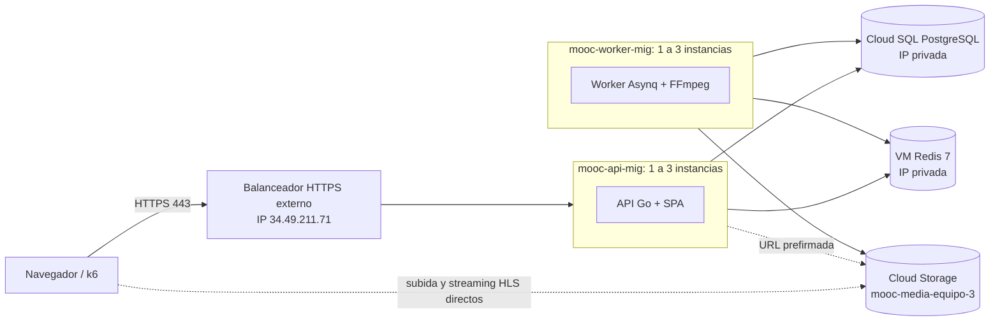

# Arquitectura elástica en GCP (Entrega 3)

> Borrador armado a partir de lo ya documentado en el repo (`capacity-planning/pruebas_de_carga_entrega3.md`,
> `deploy/startup/startup.sh`, `.github/workflows/deploy.yml`, `scripts/gcp/`, `docs/OPERACIONES.md`).
> Los puntos marcados **[Confirmar]** los debe verificar quien configuró esa parte en GCP.

## 1. Visión general

La Entrega 2 desplegaba dos VMs fijas (`web-server` y `worker-server`). En la Entrega 3 la API y
los workers corren en dos **grupos de instancias administrados (MIG)** independientes, detrás de un
**balanceador HTTPS externo**, y cada grupo escala solo según la carga de CPU.

## 2. Componentes

| Componente | Recurso en GCP | Función |
|---|---|---|
| Balanceador | External HTTPS Application Load Balancer, backend service `mooc-api-backend-service`, certificado autofirmado | Punto de entrada único. Reparte el tráfico entre las instancias sanas de la API |
| API | MIG `mooc-api-mig`, `us-central1-a` | Backend Go (chi) que además sirve la SPA de React. Sin estado local |
| Workers | MIG `mooc-worker-mig`, `us-central1-a` | Procesan en segundo plano la transcodificación HLS (FFmpeg) desde la cola Asynq |
| Cola y caché | VM con Redis 7 fuera de los MIG | Cola de tareas, idempotencia y límite de tasa |
| Base de datos | Cloud SQL PostgreSQL `mooc-db-instance`, red VPC privada | Persistencia transaccional |
| Objetos | Cloud Storage `mooc-media-equipo-3` | Videos originales, renditions HLS y materiales. Subida y descarga directas con URLs prefirmadas |
| Secretos | Secret Manager | Contenido del `.env` de cada rol |
| Imágenes | Artifact Registry | Imagen Docker única (`backend/Dockerfile`) con API, worker y SPA |

## 3. Elasticidad

| Parámetro | API | Worker |
|---|---|---|
| Mínimo / máximo de instancias | 1 / 3 | 1 / 3 |
| Métrica | CPU media 60 % (`target-cpu = 0.6`) | CPU media 60 % |
| Enfriamiento | 120 s | **[Confirmar]** |
| Health check | `GET /health`, puerto 8080, cada 15 s | **[Confirmar]** |

- **Por qué dos grupos:** las transcodificaciones de video consumen mucha CPU. Separarlas evita que
  afecten la latencia de la API (en las pruebas la API se mantuvo bajo 90 ms con 10 subidas concurrentes).
- **Por qué es posible escalar:** ninguna instancia guarda estado propio. La persistencia está en
  PostgreSQL, los archivos en Cloud Storage y las colas, la idempotencia y el límite de tasa en Redis.
- **Encendido y apagado:** `scripts/gcp/encender.ps1` y `apagar.ps1` activan o desactivan el
  autoescalado de ambos MIG (1 a 3) y encienden o apagan Cloud SQL, para controlar el costo.

## 4. Aprovisionamiento de cada instancia

Todas las instancias se crean desde una plantilla con el mismo `startup-script`
(`deploy/startup/startup.sh`), que corre en cada arranque:

1. Lee de los metadatos de la plantilla el rol (`mooc-role`: `api` o `worker`), el secreto y la imagen.
2. Instala Docker si hace falta y obtiene un token de la cuenta de servicio de la VM.
3. Descarga el `.env` desde Secret Manager (sin credenciales en disco ni en el repositorio).
4. Descarga la imagen de Artifact Registry y arranca el contenedor: la API en los puertos 80 y 8080,
   el worker con `/app/worker`.

## 5. Flujos principales

- **Peticiones de la API:** navegador → balanceador → una instancia sana de la API → PostgreSQL / Redis.
- **Subida de video:** la API entrega una URL prefirmada; el navegador sube directo a Cloud Storage
  (ningún binario pasa por la API) y avisa con `complete-upload`. La API encola la tarea en Redis.
- **Transcodificación:** un worker toma la tarea, genera las resoluciones 1080p, 720p, 480p y 360p
  y las guarda en Cloud Storage. El recurso solo se muestra como disponible cuando está listo.
- **Reproducción:** el navegador pide una URL prefirmada y descarga los segmentos HLS directo de
  Cloud Storage.

## 6. Seguridad y red

- **[Confirmar]** Solo el balanceador tiene entrada desde Internet. Redis y Cloud SQL usan IP privada
  y solo reciben tráfico interno de la VPC (reglas de firewall exactas por confirmar).
- Los contenedores corren como usuario no root (`backend/Dockerfile`).
- El servidor aplica cabeceras de seguridad (CSP restringida a los hosts de Cloud Storage), roles por
  ruta (`AccessPolicy`) y verificación de propiedad de cursos.
- Los secretos viven en Secret Manager y la cuenta de servicio de cada VM solo accede al suyo.
- HTTPS usa un certificado autofirmado porque no hay dominio propio (deuda **D-11**).

## 7. Despliegue continuo

Cuando el CI de `main` termina bien, `.github/workflows/deploy.yml` construye la imagen con el hash del
commit, la sube a Artifact Registry y actualiza los grupos para que las instancias nuevas arranquen
con ella. Detalle en [`docs/CD.md`](../CD.md) (pendiente de actualizar, deuda **D-13**).

## 8. Disponibilidad, respaldo y límites

- **Respaldo y restauración:** procedimiento con RPO y RTO medidos en [`docs/OPERACIONES.md`](../OPERACIONES.md).
- **Límites conocidos** (detalle en `capacity-planning/pruebas_de_carga_entrega3.md`): con 400 usuarios
  virtuales el cuello de botella es el pool de conexiones hacia PostgreSQL.
- **Puntos únicos de falla aceptados:** la VM de Redis y la instancia de Cloud SQL no tienen alta
  disponibilidad (deuda **D-12**).
- Las pruebas de carga, los resultados y el comparativo con la Entrega 2 están en
  [`capacity-planning/pruebas_de_carga_entrega3.md`](../../capacity-planning/pruebas_de_carga_entrega3.md).
