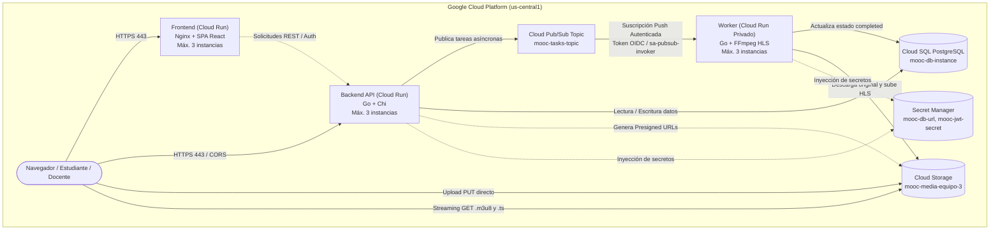

# Arquitectura Serverless en GCP (Entrega 4: Cloud Run y Cloud Pub/Sub)

## 1. Visión General

La arquitectura de la Plataforma MOOC evoluciona de la infraestructura basada en Máquinas Virtuales y Grupos de Instancias Administrados (IaaS de la Entrega 3) a una topología completamente administrada y elástica (**PaaS / Serverless**) sobre **Google Cloud Run** y **Cloud Pub/Sub**.

---

## 2. Especificación Técnica de los 3 Servicios en Cloud Run

Cada uno de los tres servicios opera de forma **stateless (sin estado local persistente)**, permitiendo que Cloud Run cree, destruya o redistribuya réplicas dinámicamente sin pérdida de información:

| Parámetro | Servicio 1: Frontend (`mooc-frontend`) | Servicio 2: Backend (`mooc-backend`) | Servicio 3: Worker (`mooc-worker`) |
| :--- | :--- | :--- | :--- |
| **Responsabilidad** | Servir los archivos estáticos de la SPA React compilada. | Exponer la API REST, autenticar usuarios y publicar tareas en Pub/Sub. | Recibir notificaciones push de Pub/Sub y transcodificar video HLS con FFmpeg. |
| **Imagen de Contenedor** | Nginx Alpine (`frontend/Dockerfile`) | Go Binary + Migraciones (`backend/Dockerfile.backend`) | Go HTTP Server + FFmpeg (`backend/Dockerfile.worker`) |
| **Región** | `us-central1` | `us-central1` | `us-central1` |
| **Mínimo de Instancias** | `0` (escala a cero para control de costos) | `0` (o `1` para mitigar cold starts) | `0` (solo se activa al recibir mensajes push) |
| **Máximo de Instancias** | **`3`** *(Requisito estricto)* | **`3`** *(Requisito estricto)* | **`3`** *(Requisito estricto)* |
| **CPU** | `1 vCPU` | `1 vCPU` | `2 vCPU` (necesario para codificación multi-resolución) |
| **Memoria RAM** | `512 MiB` | `1 GiB` | `2 GiB` (soporte de buffer para video HD) |
| **Concurrencia Máxima** | `80` solicitudes por contenedor | `80` solicitudes por contenedor | **`1`** (para garantizar que cada tarea pesada genere una nueva réplica) |
| **Timeout de Solicitud** | `60s` | `60s` | **`600s` (10 min)** (compatible con el `ack-deadline` de Pub/Sub) |
| **Tipo de Acceso** | Público (`--allow-unauthenticated`) | Público (`--allow-unauthenticated`) | **Privado (`--no-allow-unauthenticated`)** |

---

## 3. Desacoplamiento Asíncrono con Cloud Pub/Sub

El mecanismo de mensajería previo basado en Redis y la librería Asynq fue sustituido por **Google Cloud Pub/Sub**:

1. **Publicación Desacoplada**:
   - Cuando un docente finaliza la carga de un archivo de video (`POST /api/v1/media/resources/:id/complete-upload`), el backend publica un mensaje en el topic `mooc-tasks-topic`.
   - El backend responde inmediatamente al cliente con `200 OK` informando que el recurso está en estado `processing`, sin bloquear la conexión HTTP.
2. **Entrega Push Autenticada**:
   - Cloud Pub/Sub entrega cada mensaje mediante una solicitud HTTP `POST /pubsub/transcode` dirigida al servicio `mooc-worker`.
   - La suscripción push genera automáticamente un token de identidad OIDC (`roles/run.invoker`) asociado a la cuenta de servicio `sa-pubsub-invoker`.
   - Ningún usuario o entidad externa puede invocar directamente el endpoint del Worker.
3. **Confirmación (ACK) y Reintentos (NACK)**:
   - El worker devuelve `HTTP 200 OK` **únicamente después** de que FFmpeg terminó de generar los segmentos HLS, subió los archivos al bucket de Cloud Storage y actualizó la fila en PostgreSQL a estado `completed`.
   - Si ocurre una falla transitoria o error en base de datos, el worker responde con `HTTP 500`, provocando que Pub/Sub reintente la entrega siguiendo la política exponencial configurada.
4. **Idempotencia Garantizada**:
   - Ante eventuales reentregas de Pub/Sub (*at-least-once delivery*), el worker verifica dos condiciones antes de invocar FFmpeg:
     1. Si el recurso en PostgreSQL ya figura como `completed`.
     2. Si el manifiesto `hls/<resource-id>/master.m3u8` ya existe en Cloud Storage.
   - Si alguna se cumple, el worker registra `[WORKER-IDEMPOTENCY]`, marca el recurso completado si hiciera falta y responde `HTTP 200 OK` de inmediato, evitando duplicidad de cómputo y corrupción de archivos.

---

## 4. Seguridad, IAM y Cuentas de Servicio con Mínimos Privilegios

| Cuenta de Servicio | Roles Asignados | Justificación de Mínimo Privilegio |
| :--- | :--- | :--- |
| **`sa-mooc-backend`** | `roles/cloudsql.client` `roles/pubsub.publisher` `roles/storage.objectAdmin` `roles/secretmanager.secretAccessor` | Solo puede conectarse a Cloud SQL, publicar en el topic de tareas, firmar URLs de almacenamiento y leer sus propios secretos. No tiene permisos de administración. |
| **`sa-mooc-worker`** | `roles/cloudsql.client` `roles/storage.objectAdmin` `roles/secretmanager.secretAccessor` | Solo puede actualizar el estado en base de datos, manipular archivos en el bucket y leer secretos. No puede publicar en Pub/Sub ni recibir tráfico público. |
| **`sa-pubsub-invoker`** | `roles/run.invoker` (exclusivo sobre `mooc-worker`) | Utilizada únicamente por la suscripción push de Pub/Sub para autenticar la invocación contra el servicio privado del worker. |

---

## 5. Justificación de Configuración de Autoescalado

- **Por qué Concurrencia = 1 en el Worker**:  
  La transcodificación HLS con FFmpeg es una operación ligada a CPU al 100%. Permitir múltiples transcodificaciones en un solo contenedor provocaría saturación y estrangulamiento de CPU (como ocurrió en la Entrega 2). Al fijar la concurrencia en 1, cada mensaje de video adicional fuerza a Cloud Run a levantar una réplica independiente, escalando limpiamente hasta el techo configurado de **3 instancias**.
- **Por qué Concurrencia = 80 en Backend y Frontend**:  
  Tanto la API en Go como Nginx son servidores basados en E/S asíncrona altamente eficientes que atienden cientos de peticiones con muy poco consumo de CPU, permitiendo responder con latencias inferiores a 50 ms antes de requerir una nueva instancia.
