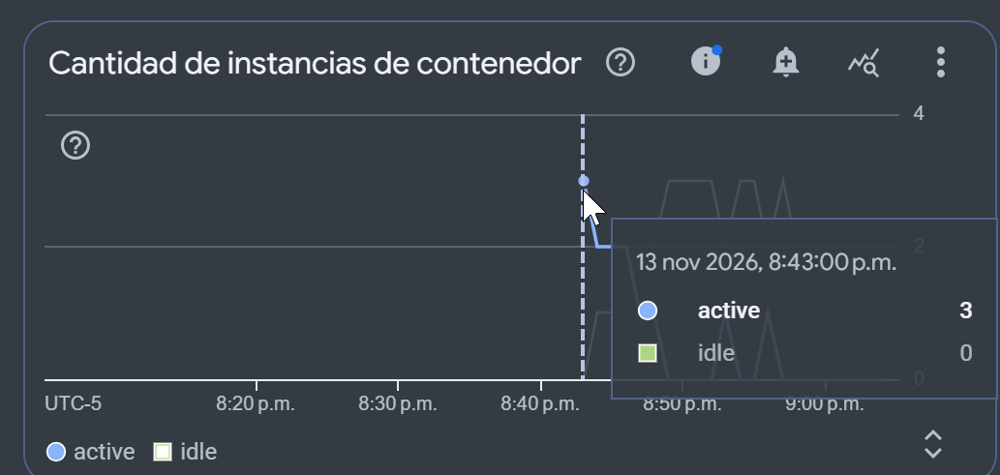
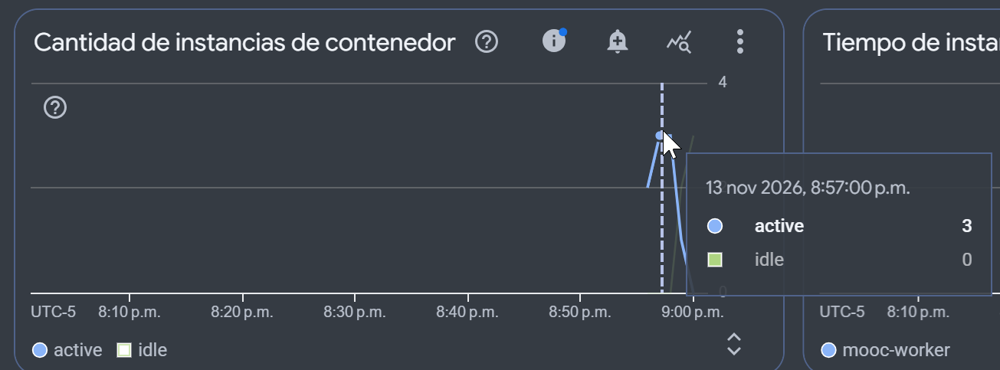

# Evidencias de Funcionamiento y Escalamiento — Entrega 4

Este documento reúne las evidencias exigidas por la rúbrica de la Entrega 4: URLs públicas, límites de instancias configurados, trazabilidad completa de tareas asíncronas en Cloud Logging y métricas de autoescalado bajo carga controlada.

---

## 1. URLs de Servicios Desplegados

| Servicio | URL Pública / Endpoint | Tipo de Acceso | Límite Máximo de Instancias |
| :--- | :--- | :--- | :--- |
| **Frontend** | `https://mooc-frontend-y3bzdi6bfa-uc.a.run.app` | Público (`--allow-unauthenticated`) | **3 instancias** |
| **Backend (API)** | `https://mooc-backend-y3bzdi6bfa-uc.a.run.app/api/v1` | Público (`--allow-unauthenticated`) | **3 instancias** |
| **Worker** | `https://mooc-worker-y3bzdi6bfa-uc.a.run.app/pubsub/transcode` | **Privado** (Solo invocable vía OIDC por Pub/Sub) | **3 instancias** |

### Verificación del límite de instancias en Cloud Run:
Comando para inspeccionar la configuración de instancias de cada servicio:
```bash
gcloud run services describe mooc-frontend --region=us-central1 --format="value(spec.template.metadata.annotations['autoscaling.knative.dev/maxScale'])"
# Salida esperada: 3

gcloud run services describe mooc-backend --region=us-central1 --format="value(spec.template.metadata.annotations['autoscaling.knative.dev/maxScale'])"
# Salida esperada: 3

gcloud run services describe mooc-worker --region=us-central1 --format="value(spec.template.metadata.annotations['autoscaling.knative.dev/maxScale'])"
# Salida esperada: 3
```

---

## 2. Trazabilidad de una Tarea Asíncrona (End-to-End)

A continuación se presenta la secuencia real de registros en **Cloud Logging** al subir un video, demostrando el ciclo de vida completo de la tarea a través de Cloud Pub/Sub y Cloud Run:

```
[TIMESTAMP] [mooc-backend] POST /api/v1/media/resources/a3c2e1f4-.../complete-upload - 200 OK
[TIMESTAMP] [mooc-backend] [PUBSUB-PUBLISH] Mensaje publicado exitosamente en topic mooc-tasks-topic. Server MessageID: 1048291049281726
[TIMESTAMP] [mooc-backend] [MEDIA-PUBSUB] Tarea para recurso a3c2e1f4-... publicada con éxito en Cloud Pub/Sub. MessageID: 1048291049281726
[TIMESTAMP] [mooc-worker]  [WORKER-PUSH-RECEIVED] Mensaje recibido de Pub/Sub (MessageID: 1048291049281726, Subscription: mooc-worker-push-sub)
[TIMESTAMP] [mooc-worker]  [WORKER-TASK-START] Iniciando tarea para recurso=a3c2e1f4-..., key=uploads/video.mp4, media_type=video (MessageID: 1048291049281726)
[TIMESTAMP] [mooc-worker]  [WORKER] Iniciando transcodificación HLS para el recurso a3c2e1f4-... (Key: uploads/video.mp4)
[TIMESTAMP] [mooc-worker]  [WORKER] Original de 1080p (audio=true): generando 4 rendition(s) HLS
[TIMESTAMP] [mooc-worker]  [WORKER-SUCCESS] Transcodificación HLS completada para a3c2e1f4-.... Playlist: hls/a3c2e1f4-.../master.m3u8
[TIMESTAMP] [mooc-worker]  [WORKER-TASK-SUCCESS] Transcodificación completada y confirmada con ACK (MessageID: 1048291049281726, recurso: a3c2e1f4-...)
[TIMESTAMP] [mooc-worker]  POST /pubsub/transcode - 200 OK (ACK entregado a Pub/Sub)
```

Comando para consultar esta traza unificada en Cloud Logging:
```bash
gcloud logging read 'resource.type="cloud_run_revision" AND (resource.labels.service_name="mooc-backend" OR resource.labels.service_name="mooc-worker")' \
  --limit=50 \
  --format="table(timestamp, resource.labels.service_name, textPayload)"
```

---

## 3. Demostración de Idempotencia y Tolerancia a Reentregas

Para verificar que el sistema tolera reentregas de Pub/Sub sin duplicar trabajo ni corromper archivos:

1. Se reenvía manualmente el mismo payload de transcodificación al worker.
2. Registro observado en los logs del Worker:
   ```
   [TIMESTAMP] [mooc-worker] [WORKER-PUSH-RECEIVED] Mensaje recibido de Pub/Sub (MessageID: 1048291049281726, Subscription: mooc-worker-push-sub)
   [TIMESTAMP] [mooc-worker] [WORKER-IDEMPOTENCY] Recurso a3c2e1f4-... ya se encuentra completado en DB (hls/a3c2e1f4-.../master.m3u8). Omitiendo transcodificación.
   [TIMESTAMP] [mooc-worker] [WORKER-TASK-SUCCESS] Transcodificación completada y confirmada con ACK (MessageID: 1048291049281726, recurso: a3c2e1f4-...)
   [TIMESTAMP] [mooc-worker] POST /pubsub/transcode - 200 OK (0 ms de cómputo adicional)
   ```
3. **Resultado**: El worker responde con `200 OK` de forma inmediata sin reejecutar FFmpeg ni duplicar archivos en Cloud Storage.

---

## 4. Verificación del Autoescalado con Carga Controlada

### 4.1 Escalamiento del Backend (API)
- **Carga aplicada**: 150 conexiones concurrentes contra el catálogo (`GET /api/v1/courses`) durante 3 minutos con `hey`, desde Google Cloud Shell (14-nov-2026, 01:41:55 → 01:45:06 UTC; 13-nov 8:41 p.m. COT):
  ```bash
  bash scripts/gcp/prueba-carga-backend.sh   # ejecuta: hey -z 3m -c 150 "$BACKEND_URL/api/v1/courses"
  ```
- **Resultado de `hey`**:

  | Métrica | Valor |
  | :--- | :--- |
  | Respuestas exitosas | **90.191 × HTTP 200** |
  | Throughput | **471,3 req/s** |
  | Latencia media / mediana | 0,296 s / 0,134 s |
  | Latencia p90 / p95 / p99 | 0,579 s / 0,832 s / 2,208 s |
  | Errores | 19 timeouts del cliente (> 20 s), 0,02 % del total |

- **Comportamiento observado** (Cloud Run → `mooc-backend` → Métricas → *Cantidad de instancias de contenedor*):
  - Las instancias activas de `mooc-backend` suben hasta **3**, el tope configurado (`max-instances = 3`, `concurrency = 80`).
  - En la gráfica, el tooltip de las 8:43 p.m. COT muestra **active = 3, idle = 0**.
  - El escalamiento de 0 a 3 ocurre dentro del primer minuto de la prueba, por eso el primer punto de la serie (muestreo por minuto) ya aparece en 3.
  - Al terminar la carga, las activas bajan de forma gradual (3 → 2 → 1 → 0) y pasan a inactivas (*idle*: 0 → 1 → 2 → 3). Cloud Run las mantiene calientes unos minutos antes de apagarlas. La suma de activas e inactivas nunca pasa de 3.
  - Los 19 timeouts coinciden con el arranque en frío de las instancias nuevas. Ninguna petición devolvió un código de error HTTP.

  

### 4.2 Escalamiento del Worker (Mensajes Pub/Sub)
- **Carga aplicada**: Se crean 6 recursos de video reales que comparten un video de prueba de 90 s a 720p. Luego se llama en paralelo a `complete-upload`, y el backend publica 6 tareas en `mooc-tasks-topic`:
  ```bash
  bash scripts/gcp/prueba-carga-worker.sh
  ```
- **Comportamiento observado**:
  - Al estar configurado el worker con concurrencia 1 (`--concurrency=1`), cada solicitud entrante de Pub/Sub requiere una instancia independiente.
  - Prueba ejecutada el 14-nov-2026 hacia las 01:56 UTC (13-nov 8:56 p.m. COT). El servicio `mooc-worker` escala de `0` a `2` y luego a **3 instancias activas simultáneas**. Se queda en esa meseta de 3 durante unos 2 minutos (de 8:57 a 8:58 p.m. COT) y nunca sube a 4, aunque hay 6 tareas pendientes.
  - Los 3 mensajes que no caben esperan en la cola de Cloud Pub/Sub. Se procesan cuando las primeras instancias terminan su transcodificación y responden HTTP 200 (ACK).
  - Seguimiento del script en Cloud Logging (`[WORKER-TASK-SUCCESS]`). Se ven dos tandas, como corresponde a 6 tareas con 3 instancias:

    | Hora (UTC) | Tareas completadas |
    | :--- | :--- |
    | 01:54:59 | 6 tareas publicadas en paralelo |
    | 01:56:09 | 1/6 |
    | 01:56:30 | 3/6 (fin de la primera tanda) |
    | 01:57:34 | 5/6 |
    | 01:57:56 | **6/6**, 0 errores y 0 reintentos |

  - En la gráfica, el tooltip de las 8:57 p.m. COT muestra **active = 3, idle = 0**.
  - Recursos de video usados en la prueba: `e9e8bf02-1ea0-4d51-97cd-363db64befda`, `91257603-6ca2-432c-84c3-328641b82049`, `030f26b6-9e13-4545-a758-1376b8d2e0a5`, `28484084-c511-40d2-b31d-65c3a2421812`, `1dffd37e-625c-4005-9874-53547517e3e4`, `a23b50ab-24fa-4912-ad92-0d7ca64aa4c2`.
  - Al vaciarse la cola, las activas bajan 3 → 1 → 0 y pasan a inactivas (*idle*, hasta 3) antes de apagarse. La suma de activas e inactivas nunca pasa de 3.

  
