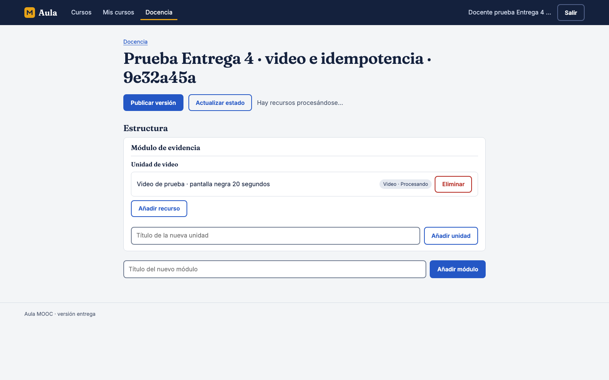
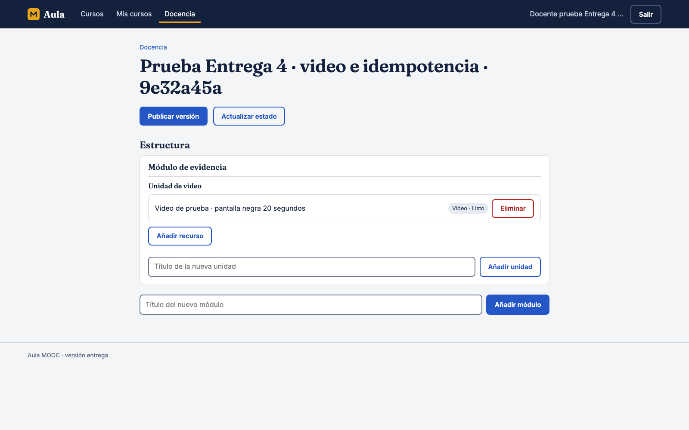
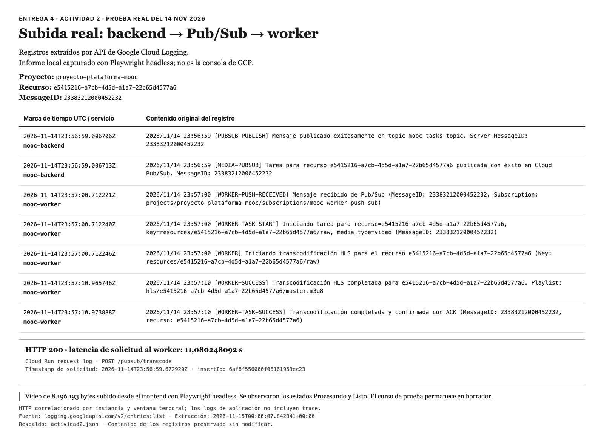
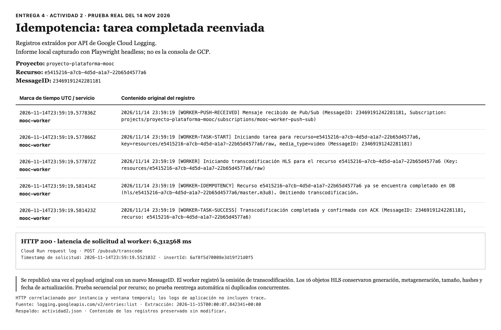
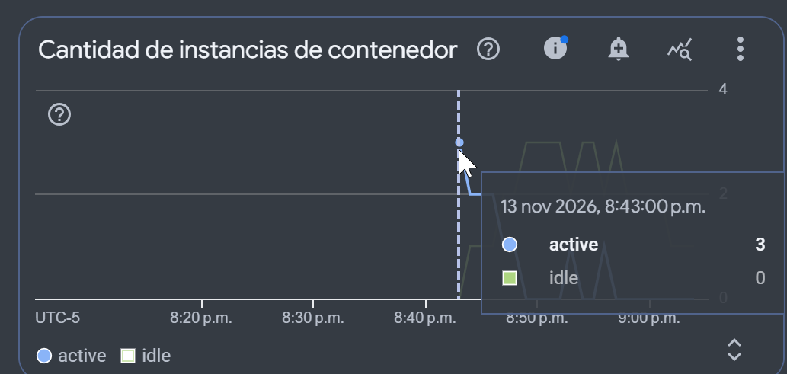
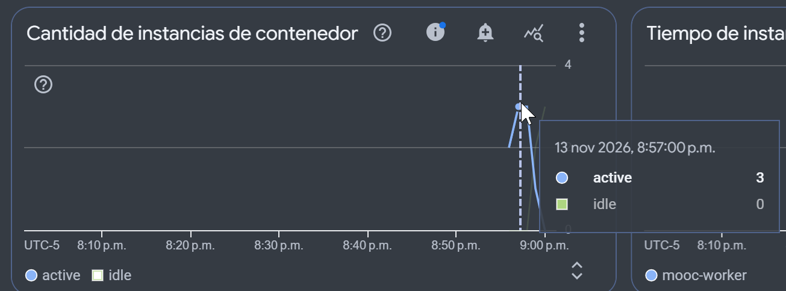

# Evidencias de Funcionamiento y Escalamiento — Entrega 4

Este documento reúne las evidencias exigidas por la rúbrica de la Entrega 4: URLs públicas, límites de instancias configurados, trazabilidad completa de tareas asíncronas en Cloud Logging y métricas de autoescalado bajo carga controlada.

---

## 1. URLs de Servicios Desplegados

| Servicio | URL Pública / Endpoint | Tipo de Acceso | Límite Máximo de Instancias |
| :--- | :--- | :--- | :--- |
| **Frontend** | `https://mooc-frontend-y3bzdi6bfa-uc.a.run.app` | Público (`--allow-unauthenticated`) | **3 instancias** |
| **Backend (API)** | `https://mooc-backend-y3bzdi6bfa-uc.a.run.app/api/v1` | Público (`--allow-unauthenticated`) | **3 instancias** |
| **Worker** | `https://mooc-worker-y3bzdi6bfa-uc.a.run.app/pubsub/transcode` | **Privado** (Solo invocable vía OIDC por Pub/Sub) | **3 instancias** |

### Verificación del límite de instancias en Cloud Run:
Comando para inspeccionar la configuración de instancias de cada servicio:
```bash
gcloud run services describe mooc-frontend --region=us-central1 --format="value(spec.template.metadata.annotations['autoscaling.knative.dev/maxScale'])"
# Salida esperada: 3

gcloud run services describe mooc-backend --region=us-central1 --format="value(spec.template.metadata.annotations['autoscaling.knative.dev/maxScale'])"
# Salida esperada: 3

gcloud run services describe mooc-worker --region=us-central1 --format="value(spec.template.metadata.annotations['autoscaling.knative.dev/maxScale'])"
# Salida esperada: 3
```

---

## 2. Trazabilidad de una Tarea Asíncrona (End-to-End)

La prueba se ejecutó el **14 de noviembre de 2026, aproximadamente a las 18:56 COT (23:56 UTC)**, mediante el frontend desplegado y Playwright en modo headless. Se creó un docente de prueba y un curso con módulo y unidad; el curso permaneció **en borrador**. La selección del archivo y su envío se realizaron mediante los controles reales de la interfaz, sin simular respuestas ni sustituir el flujo de subida por llamadas directas de prueba.

### 2.1 Video y subida desde el frontend

| Dato | Valor verificado |
| :--- | :--- |
| Archivo seleccionado | `video-prueba-20s.mp4` |
| Tamaño | **8.196.193 bytes** (8,20 MB) |
| Duración | **20,69 segundos** |
| Video | H.264, 1280 × 720, 50 fps |
| SHA-256 del archivo local | `bfe2554a182d08c3cda294033b2656c2ded9416269e1608c5be1c947e56705c7` |
| Docente | `98ea49e6-9e8c-4c68-b51c-b1994c3df4ea` |
| Curso de prueba | `9ca05e46-b1fe-4b7d-8830-938baf2415c4` |
| Recurso de video | `e5415216-a7cb-4d5d-a1a7-22b65d4577a6` |
| Objeto original | `resources/e5415216-a7cb-4d5d-a1a7-22b65d4577a6/raw` |

Se preparó una copia del video proporcionado mediante recodificación H.264 a bitrate constante; se conservó la duración y el contenido visual, con SSIM 1,000000, y se verificó su decodificación completa. El archivo original no se modificó. El SHA-256 de la tabla corresponde al archivo local seleccionado, no a una comprobación remota del checksum del objeto de Cloud Storage. El comando y las validaciones están en [video-preparado.json](evidencias/video-preparado.json).

El navegador registró la creación del recurso con HTTP 201, la subida `PUT` a Cloud Storage con HTTP 200 y la llamada `complete-upload` con HTTP 200. Se observaron los siguientes estados reales en la interfaz:

| Evento observado | Fecha y hora UTC |
| :--- | :--- |
| Creación del recurso confirmada | 2026-11-14 23:56:46.328 |
| Subida confirmada por `complete-upload` | 2026-11-14 23:56:59.022 |
| Etiqueta «Video · Procesando» visible | 2026-11-14 23:56:59.318 |
| Etiqueta «Video · Listo» observada por primera vez | 2026-11-14 23:57:11.660 |
| Captura final conservada de «Video · Listo» | 2026-11-14 23:58:44.586 |

Las marcas de esta tabla son observaciones del navegador; no deben interpretarse como tiempos exactos de transición de la base de datos. La imagen final de «Listo» se volvió a capturar después de la primera observación para conservar una vista estable de la interfaz.





### 2.2 Publicación, recepción y procesamiento

La API publicó la tarea en `mooc-tasks-topic` con **MessageID `23383212000452232`**. La suscripción `mooc-worker-push-sub` la entregó al worker, que produjo la playlist `hls/e5415216-a7cb-4d5d-a1a7-22b65d4577a6/master.m3u8`.

Estos son los registros reales seleccionados. Cada línea añade la marca de tiempo UTC y el servicio al contenido original de `textPayload`:

```text
2026-11-14T23:56:59.006706Z [mooc-backend] 2026/11/14 23:56:59 [PUBSUB-PUBLISH] Mensaje publicado exitosamente en topic mooc-tasks-topic. Server MessageID: 23383212000452232
2026-11-14T23:56:59.006713Z [mooc-backend] 2026/11/14 23:56:59 [MEDIA-PUBSUB] Tarea para recurso e5415216-a7cb-4d5d-a1a7-22b65d4577a6 publicada con éxito en Cloud Pub/Sub. MessageID: 23383212000452232
2026-11-14T23:57:00.712221Z [mooc-worker] 2026/11/14 23:57:00 [WORKER-PUSH-RECEIVED] Mensaje recibido de Pub/Sub (MessageID: 23383212000452232, Subscription: projects/proyecto-plataforma-mooc/subscriptions/mooc-worker-push-sub)
2026-11-14T23:57:00.712240Z [mooc-worker] 2026/11/14 23:57:00 [WORKER-TASK-START] Iniciando tarea para recurso=e5415216-a7cb-4d5d-a1a7-22b65d4577a6, key=resources/e5415216-a7cb-4d5d-a1a7-22b65d4577a6/raw, media_type=video (MessageID: 23383212000452232)
2026-11-14T23:57:00.712246Z [mooc-worker] 2026/11/14 23:57:00 [WORKER] Iniciando transcodificación HLS para el recurso e5415216-a7cb-4d5d-a1a7-22b65d4577a6 (Key: resources/e5415216-a7cb-4d5d-a1a7-22b65d4577a6/raw)
2026-11-14T23:57:10.965746Z [mooc-worker] 2026/11/14 23:57:10 [WORKER-SUCCESS] Transcodificación HLS completada para e5415216-a7cb-4d5d-a1a7-22b65d4577a6. Playlist: hls/e5415216-a7cb-4d5d-a1a7-22b65d4577a6/master.m3u8
2026-11-14T23:57:10.973888Z [mooc-worker] 2026/11/14 23:57:10 [WORKER-TASK-SUCCESS] Transcodificación completada y confirmada con ACK (MessageID: 23383212000452232, recurso: e5415216-a7cb-4d5d-a1a7-22b65d4577a6)
```

Los registros HTTP de Cloud Run confirman respuestas **200** para `complete-upload` y `/pubsub/transcode`. La latencia del primero fue **174,247 ms**; la solicitud original al worker registró **11,080 s** (`11.080248092s`). Esta es la latencia de la solicitud HTTP, no una medición aislada del consumo de CPU de FFmpeg.

La correlación de los logs de aplicación se realiza mediante `resource_id` y `MessageID`. Los logs HTTP del worker no incluyen esos campos: su asociación con la tarea se infiere por la **misma instancia y ventana temporal**. Aunque los registros HTTP tienen `trace`, los de aplicación no lo incorporan, por lo que no se presenta como una traza distribuida explícita.



La captura anterior es un informe local de registros obtenidos mediante la API de Cloud Logging, no una captura de la consola web de GCP. El respaldo verificable, con marcas de tiempo, `insertId`, revisiones, instancias y registros HTTP, está en [actividad2.json](evidencias/actividad2.json).

Comando de consulta de los registros de aplicación de esta tarea:

```bash
gcloud logging read 'resource.type="cloud_run_revision" AND (resource.labels.service_name="mooc-backend" OR resource.labels.service_name="mooc-worker") AND timestamp >= "2026-11-14T23:56:00Z" AND timestamp <= "2026-11-15T00:01:00Z" AND (textPayload:"e5415216-a7cb-4d5d-a1a7-22b65d4577a6" OR textPayload:"23383212000452232" OR textPayload:"23469191242281181")' \
  --project=proyecto-plataforma-mooc \
  --order=asc --limit=100 \
  --format="table(timestamp, resource.labels.service_name, textPayload)"
```

---

## 3. Demostración de Idempotencia por Recurso

Después de completar la primera tarea, se **republicó una vez el mismo payload** en `mooc-tasks-topic`, conservando el ID del recurso y la clave real del video:

```json
{
  "resource_id": "e5415216-a7cb-4d5d-a1a7-22b65d4577a6",
  "original_key": "resources/e5415216-a7cb-4d5d-a1a7-22b65d4577a6/raw",
  "media_type": "video"
}
```

Pub/Sub asignó a esta nueva publicación el **MessageID `23469191242281181`**, distinto del original. Por tanto, la prueba demuestra idempotencia secuencial por recurso al recibir nuevamente la misma tarea; **no demuestra la reentrega automática del mismo mensaje ni el procesamiento concurrente de duplicados**.

### 3.1 Omisión de la transcodificación y respuesta HTTP

```text
2026-11-14T23:59:19.577836Z [mooc-worker] 2026/11/14 23:59:19 [WORKER-PUSH-RECEIVED] Mensaje recibido de Pub/Sub (MessageID: 23469191242281181, Subscription: projects/proyecto-plataforma-mooc/subscriptions/mooc-worker-push-sub)
2026-11-14T23:59:19.577866Z [mooc-worker] 2026/11/14 23:59:19 [WORKER-TASK-START] Iniciando tarea para recurso=e5415216-a7cb-4d5d-a1a7-22b65d4577a6, key=resources/e5415216-a7cb-4d5d-a1a7-22b65d4577a6/raw, media_type=video (MessageID: 23469191242281181)
2026-11-14T23:59:19.577872Z [mooc-worker] 2026/11/14 23:59:19 [WORKER] Iniciando transcodificación HLS para el recurso e5415216-a7cb-4d5d-a1a7-22b65d4577a6 (Key: resources/e5415216-a7cb-4d5d-a1a7-22b65d4577a6/raw)
2026-11-14T23:59:19.581414Z [mooc-worker] 2026/11/14 23:59:19 [WORKER-IDEMPOTENCY] Recurso e5415216-a7cb-4d5d-a1a7-22b65d4577a6 ya se encuentra completado en DB (hls/e5415216-a7cb-4d5d-a1a7-22b65d4577a6/master.m3u8). Omitiendo transcodificación.
2026-11-14T23:59:19.581423Z [mooc-worker] 2026/11/14 23:59:19 [WORKER-TASK-SUCCESS] Transcodificación completada y confirmada con ACK (MessageID: 23469191242281181, recurso: e5415216-a7cb-4d5d-a1a7-22b65d4577a6)
```

El registro específico `[WORKER-IDEMPOTENCY]` indica que el recurso ya estaba completado y se omitió la transcodificación. La línea genérica «Iniciando transcodificación HLS» se emite antes de esa comprobación y no significa que FFmpeg se haya vuelto a ejecutar. Del mismo modo, `[WORKER-TASK-SUCCESS]` también se utiliza cuando la tarea termina por omisión idempotente.

La solicitud repetida al worker devolvió **HTTP 200** y registró una latencia de **6,313 ms** (`0.006312568s`). Su asociación al mensaje repetido utiliza la misma correlación por instancia y ventana temporal explicada en la sección 2.2. No se afirma un tiempo de cómputo de cero.

| Solicitud al worker | MessageID | HTTP | Latencia registrada |
| :--- | :--- | :--- | :--- |
| Procesamiento original | `23383212000452232` | 200 | 11,080 s |
| Payload republicado, recurso completado | `23469191242281181` | 200 | 6,313 ms |

### 3.2 Comprobación de los archivos HLS

Se consultaron los objetos del prefijo `hls/e5415216-a7cb-4d5d-a1a7-22b65d4577a6/` antes y después de la republicación:

- Antes: **2026-11-14 23:59:16.306834 UTC**.
- Después: **2026-11-15 00:00:08.043682 UTC** (todavía 14 de noviembre en Colombia).
- Resultado: **16 objetos HLS** en ambas consultas, con los mismos nombres, generaciones, metageneraciones, tamaños, hashes MD5, CRC32C y marcas de actualización.

Esta comparación confirma que los objetos presentes al cierre conservan su generación y contenido respecto de la consulta inicial. Los 16 objetos corresponden a una playlist maestra, tres playlists de calidad (360p, 480p y 720p) y doce segmentos. Las respuestas completas de metadatos están en [hls-antes.json](evidencias/hls-antes.json) y [hls-despues.json](evidencias/hls-despues.json); el resumen está en [actividad2.json](evidencias/actividad2.json).



La captura es un informe local de datos reales extraídos por API. La evidencia combina el log de omisión, la respuesta HTTP y la comparación de objetos; su alcance es esta repetición secuencial controlada. No constituye una prueba de carga ni de exclusión mutua entre workers concurrentes.

Cloud SQL se encendió temporalmente y volvió a su política inicial **`NEVER`**. La operación de apagado terminó correctamente el **15-nov-2026 a las 00:07:13.317 UTC** (14-nov a las 19:07:13.317 COT). La comparación final confirmó que la configuración de Cloud SQL es igual a la inicial, excepto el contador `settingsVersion`, y que las configuraciones de los tres servicios Cloud Run y la suscripción Pub/Sub no cambiaron. Se cerraron las sesiones de administrador y docente. El docente, el curso en borrador y los archivos de esta prueba se conservan para revisión. El detalle está en [cierre-actividad2.json](evidencias/cierre-actividad2.json).

---

## 4. Verificación del Autoescalado con Carga Controlada

### 4.1 Escalamiento del Backend (API)
- **Carga aplicada**: 150 conexiones concurrentes contra el catálogo (`GET /api/v1/courses`) durante 3 minutos con `hey`, desde Google Cloud Shell (14-nov-2026, 01:41:55 → 01:45:06 UTC; 13-nov 8:41 p.m. COT):
  ```bash
  bash scripts/gcp/prueba-carga-backend.sh   # ejecuta: hey -z 3m -c 150 "$BACKEND_URL/api/v1/courses"
  ```
- **Resultado de `hey`**:

  | Métrica | Valor |
  | :--- | :--- |
  | Respuestas exitosas | **90.191 × HTTP 200** |
  | Throughput | **471,3 req/s** |
  | Latencia media / mediana | 0,296 s / 0,134 s |
  | Latencia p90 / p95 / p99 | 0,579 s / 0,832 s / 2,208 s |
  | Errores | 19 timeouts del cliente (> 20 s), 0,02 % del total |

- **Comportamiento observado** (Cloud Run → `mooc-backend` → Métricas → *Cantidad de instancias de contenedor*):
  - Las instancias activas de `mooc-backend` suben hasta **3**, el tope configurado (`max-instances = 3`, `concurrency = 80`).
  - En la gráfica, el tooltip de las 8:43 p.m. COT muestra **active = 3, idle = 0**.
  - El escalamiento de 0 a 3 ocurre dentro del primer minuto de la prueba, por eso el primer punto de la serie (muestreo por minuto) ya aparece en 3.
  - Al terminar la carga, las activas bajan de forma gradual (3 → 2 → 1 → 0) y pasan a inactivas (*idle*: 0 → 1 → 2 → 3). Cloud Run las mantiene calientes unos minutos antes de apagarlas. La suma de activas e inactivas nunca pasa de 3.
  - Los 19 timeouts coinciden con el arranque en frío de las instancias nuevas. Ninguna petición devolvió un código de error HTTP.

  

### 4.2 Escalamiento del Worker (Mensajes Pub/Sub)
- **Carga aplicada**: Se crean 6 recursos de video reales que comparten un video de prueba de 90 s a 720p. Luego se llama en paralelo a `complete-upload`, y el backend publica 6 tareas en `mooc-tasks-topic`:
  ```bash
  bash scripts/gcp/prueba-carga-worker.sh
  ```
- **Comportamiento observado**:
  - Al estar configurado el worker con concurrencia 1 (`--concurrency=1`), cada instancia atiende una solicitud simultánea y puede reutilizarse para solicitudes posteriores.
  - Prueba ejecutada el 14-nov-2026 hacia las 01:56 UTC (13-nov 8:56 p.m. COT). El servicio `mooc-worker` escala de `0` a `2` y luego a **3 instancias activas simultáneas**. Se queda en esa meseta de 3 durante unos 2 minutos (de 8:57 a 8:58 p.m. COT) y nunca sube a 4, aunque hay 6 tareas pendientes.
  - Los 3 mensajes que no caben esperan en la cola de Cloud Pub/Sub. Se procesan cuando las primeras instancias terminan su transcodificación y responden HTTP 200 (ACK).
  - Seguimiento del script en Cloud Logging (`[WORKER-TASK-SUCCESS]`). Se ven dos tandas, como corresponde a 6 tareas con 3 instancias:

    | Hora (UTC) | Tareas completadas |
    | :--- | :--- |
    | 01:54:59 | 6 tareas publicadas en paralelo |
    | 01:56:09 | 1/6 |
    | 01:56:30 | 3/6 (fin de la primera tanda) |
    | 01:57:34 | 5/6 |
    | 01:57:56 | **6/6 tareas completadas** |

  - Una consulta posterior de logs HTTP para la ventana **14-nov-2026, 01:54:55–01:58:10 UTC** encontró **7 respuestas HTTP 500 del worker**, además de las seis solicitudes al worker con HTTP 200. No se atribuyen los HTTP 500 a mensajes concretos sin correlación adicional; tampoco se concluye que hubo cero reintentos. El respaldo está en [carga-worker-http.json](evidencias/carga-worker-http.json).

  - En la gráfica, el tooltip de las 8:57 p.m. COT muestra **active = 3, idle = 0**.
  - Recursos de video usados en la prueba: `e9e8bf02-1ea0-4d51-97cd-363db64befda`, `91257603-6ca2-432c-84c3-328641b82049`, `030f26b6-9e13-4545-a758-1376b8d2e0a5`, `28484084-c511-40d2-b31d-65c3a2421812`, `1dffd37e-625c-4005-9874-53547517e3e4`, `a23b50ab-24fa-4912-ad92-0d7ca64aa4c2`.
  - Al vaciarse la cola, las activas bajan 3 → 1 → 0 y pasan a inactivas (*idle*, hasta 3) antes de apagarse. La suma de activas e inactivas nunca pasa de 3.

  
