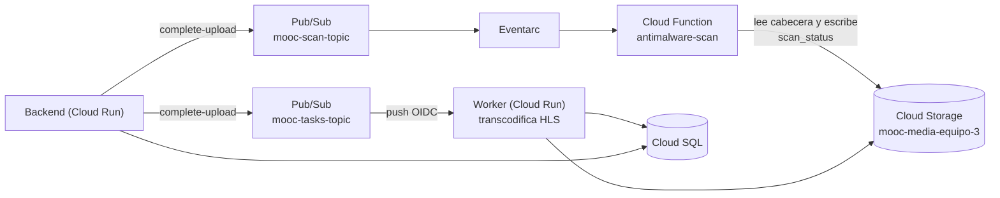

# Entrega 5: análisis serverless y cambio de arquitectura

## 1. Qué ya es serverless y qué no

| Componente | Servicio | ¿Serverless? | Comentario |
|---|---|---|---|
| Frontend (SPA en Nginx) | Cloud Run | Sí | Escala a cero, máximo 3 instancias |
| Backend (API Go) | Cloud Run | Sí | Escala a cero, máximo 3 instancias |
| Worker de transcodificación HLS | Cloud Run (privado) | Sí | Lo invoca Pub/Sub por push; concurrencia 1 y 600 s por tarea |
| Mensajería | Cloud Pub/Sub | Sí | Totalmente administrado |
| Objetos (videos, HLS) | Cloud Storage | Sí | Subida y descarga directas con URL prefirmada |
| Secretos | Secret Manager | Sí | Solo referencias desde Cloud Run y Terraform |
| Base de datos | Cloud SQL PostgreSQL | No (administrada) | Es una instancia con costo fijo mientras esté encendida |
| **Escaneo antimalware** | **Cloud Function (2.ª gen.)** | **Sí (este cambio)** | Antes lo ejecutaba el worker |

## 2. Oportunidades identificadas

| # | Componente | Servicio propuesto | Beneficio | Limitaciones | Estado |
|---|---|---|---|---|---|
| 1 | Escaneo antimalware de cada objeto subido | Cloud Function 2.ª gen. + Eventarc | Paga solo por evento, escala a cero, cuenta de servicio propia y mínima, sin tocar el worker | Arranque en frío de unos segundos; no trae FFmpeg ni herramientas nativas | **Implementada** |
| 2 | Transcodificación HLS (FFmpeg) | Transcoder API, o Cloud Run Jobs | Sin límite de 600 s de solicitud HTTP; menos mantenimiento de FFmpeg | Transcoder API cobra por minuto y genera otra escalera de resoluciones, así que no conserva el resultado actual; Jobs exige reescribir el disparo | Solo documentada |
| 3 | Insignias de finalización (deuda D-03) | Cloud Function disparada por Pub/Sub al aprobar un curso | Genera y sube la imagen sin cargar a la API | Hay que definir el evento y el formato de la imagen | Solo documentada |
| 4 | Limpieza de datos de prueba de k6 (deuda D-14) | Cloud Scheduler + Cloud Function | Tarea periódica sin servidor propio | Requiere acceso de la función a Cloud SQL | Solo documentada |
| 5 | Frontend estático | Cloud Storage + Cloud CDN (o Firebase Hosting) | Más barato y con caché global | Reglas de reescritura para la SPA y reconfigurar CORS | Solo documentada |
| 6 | Exportador de métricas de cola (`cmd/queue-metrics`) | Métricas nativas de Pub/Sub en Cloud Monitoring | Elimina un componente propio | Solo aplica ya sin Asynq/Redis | Solo documentada |

### Por qué se eligió el escaneo antimalware

- **Es corto y no necesita herramientas nativas:** lee 4 KiB del objeto y decide. Cabe en una función sin empaquetar FFmpeg (la transcodificación sí lo necesita).
- **Es naturalmente dirigida por eventos:** ocurre una vez por subida y no depende del resto del flujo.
- **Es idempotente por naturaleza:** repetirlo sobre el mismo objeto da el mismo resultado.
- **Riesgo bajo:** no está en la ruta crítica del estudiante ni del docente. Si falla, la carga y la transcodificación siguen.

## 3. El cambio implementado

La función no usa Cloud SQL: el resultado queda en la metadata del propio objeto.

**Qué cambió en el código**

| Archivo | Cambio |
|---|---|
| `functions/antimalware-scan/` | Función nueva (`function.go`) y su lógica pura con pruebas (`scanner/`) |
| `backend/internal/media/handler.go` | `complete-upload` publica el mensaje de escaneo en su topic (`PUBSUB_SCAN_TOPIC`); es de mejor esfuerzo |
| `backend/internal/config/config.go`, `backend/cmd/api/main.go` | Nueva variable y publicador del topic de escaneo |
| `backend/internal/worker/` | Se eliminó `HandleAntimalwareScan` y su tarea: el worker ya no ejecuta el escaneo |
| `infra/terraform/` | Todo el despliegue (ver [guía](../../infra/terraform/README.md)) |

### Comportamiento conservado y diferencias

- **Se conserva:** la verificación por firma binaria del objeto en Cloud Storage y el resultado «apto» para un objeto normal.
- **Se agrega:** el resultado queda registrado en la metadata del objeto (`scan_status`, `scan_detected`, `scan_at`, `scan_resource_id`) y la función rechaza objetos vacíos, demasiado grandes, ejecutables (PE, ELF, Mach-O, scripts con `#!`) y el archivo de prueba EICAR.
- **Honestidad sobre el original:** la tarea que ejecutaba el worker solo comprobaba que el objeto existiera y escribía un log de «APTO»; nadie la publicaba en la práctica. Por eso el resultado verificable de esta entrega es la metadata.
- **Limitación:** un objeto marcado `rejected` no se borra ni bloquea su reproducción; la decisión queda registrada para que el backend la use en una entrega futura.

### Reintentos sin duplicar efectos

1. Pub/Sub entrega **al menos una vez**, y el disparador de Eventarc usa `RETRY_POLICY_RETRY`: ante un error de la función reintenta con espera creciente.
2. La función devuelve error **solo** ante fallos transitorios (Cloud Storage no responde, no se pudo guardar el resultado). Un mensaje irrecuperable (JSON roto, objeto inexistente, bucket no permitido) se confirma y se descarta con el log `[SCAN-IGNORED]`.
3. **Idempotencia:** si el objeto ya tiene `scan_status`, la función termina sin escribir (`[SCAN-IDEMPOTENT]`). Además, el resultado se guarda con la condición `GenerationMatch`: si el objeto cambió mientras se escaneaba, la escritura falla y el reintento lo vuelve a escanear.
4. El backend puede reenviar el mensaje repitiendo `complete-upload`; el efecto es el mismo.

## 4. Seguridad y permisos

| Cuenta de servicio | Permisos | Alcance |
|---|---|---|
| `sa-mooc-scan` (la función) | `storage.objectUser` | Solo el bucket de medios |
| `sa-eventarc-scan` (el disparador) | `eventarc.eventReceiver` y `run.invoker` | El proyecto y solo el servicio de la función |
| `sa-mooc-backend` | `pubsub.publisher` | Solo los dos topics |
| `sa-mooc-worker` | `storage.objectAdmin`, `cloudsql.client` | Bucket de medios; Cloud SQL |
| `sa-pubsub-invoker` | `run.invoker` | Solo el servicio del worker |

Los secretos se leen desde Secret Manager con acceso por secreto, y Terraform solo los referencia: sus valores no están en el código ni en el estado.
